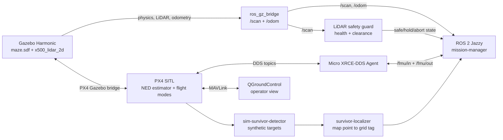
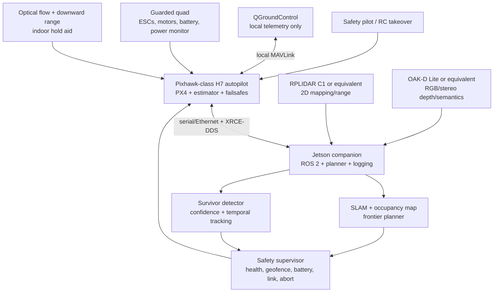

# AirMouse architecture

## Current simulation



The mission manager publishes `OffboardControlMode`, `TrajectorySetpoint`,
and `VehicleCommand` messages to PX4. It subscribes to PX4 local position and
vehicle status. The synthetic detector converts known SDF marker positions into
map points; it is deliberately replaceable and must not be mistaken for a
camera model.

## Current ROS interfaces

| Interface | Type | Purpose |
| --- | --- | --- |
| `/scan` | `sensor_msgs/msg/LaserScan` | Gazebo 2D LiDAR bridge output |
| `/odom` | `nav_msgs/msg/Odometry` | Gazebo odometry bridge output |
| `/fmu/in/offboard_control_mode` | `px4_msgs/msg/OffboardControlMode` | PX4 offboard heartbeat/control type |
| `/fmu/in/trajectory_setpoint` | `px4_msgs/msg/TrajectorySetpoint` | Position setpoints in PX4 NED |
| `/fmu/in/vehicle_command` | `px4_msgs/msg/VehicleCommand` | Arm, mode, land, RTL commands |
| `/airmouse/mission_state` | `std_msgs/msg/String` | State-machine state |
| `/airmouse/mission_status` | `std_msgs/msg/String` | JSON status snapshot |
| `/airmouse/mission_plan` | `std_msgs/msg/String` | JSON route/plan snapshot |
| `/airmouse/detections/map_point` | `geometry_msgs/msg/PointStamped` | Replaceable detection output |
| `/airmouse/survivors/grid_tags` | `std_msgs/msg/String` | De-duplicated grid-tag JSON |
| `/airmouse/start` | `std_srvs/srv/Trigger` | Start the mission |
| `/airmouse/abort` | `std_srvs/srv/Trigger` | Request RTL/abort |
| `/airmouse/complete` | `std_srvs/srv/Trigger` | Controlled completion request |
| `/airmouse/safety/status` | `std_msgs/msg/String` | JSON LiDAR health, clearance, and failure reason |
| `/airmouse/safety/lidar_ready` | `std_msgs/msg/Bool` | Valid, non-stale LiDAR stream gate |
| `/airmouse/safety/lidar_safe` | `std_msgs/msg/Bool` | Closest valid range is outside the stop distance |

## Frame contract

The simulation currently crosses three conventions:

1. Gazebo world coordinates are treated as ENU-style `x/y/z` for the maze.
2. ROS geometry messages should use an explicit `map`/`odom` frame and TF.
3. PX4 `VehicleLocalPosition` and trajectory setpoints use local NED.

Every real node must document its frame and timestamp. No node should silently
assume ENU equals NED. The conversion used by this project is:

```text
PX4 NED (x, y, z) = (Gazebo y, Gazebo x, -Gazebo z)
```

For the physical vehicle, establish `base_link`, `imu_link`, `lidar_link`,
`camera_link`, `camera_optical_frame`, and `range_link` using measured static
extrinsics. Record the calibration date and tool/version in the flight log.

## Target real architecture



The autopilot owns stabilization, actuator output, arming, core estimator,
geofence, link-loss, battery, and mode failsafes. The companion owns sensing,
mapping, survivor confidence, exploration, grid tagging, and high-level
setpoints. A companion failure must leave the autopilot able to reject unsafe
commands and enter a tested fallback mode.

The current `lidar-safety` node is a conservative guard around the scripted
simulation route. It validates scan freshness and valid-beam count, inflates
the configured stop distance using the vehicle envelope and uncertainty
margin, holds the current setpoint when a scan is unsafe, and requests PX4 RTL
if the condition persists. A SLAM/frontier planner is still required for
unknown-maze exploration.

## Replacement boundaries

The simulation-to-real migration should replace one boundary at a time:

| Simulation component | Real replacement | Acceptance evidence |
| --- | --- | --- |
| Gazebo LiDAR bridge | Vendor driver + timestamp/extrinsic calibration | Stable scan rate, range sanity, bag replay |
| Gazebo odometry | VIO/optical flow/SLAM estimate | Drift and loss-of-tracking report |
| Synthetic detector | Camera detector + tracker | Labeled dataset precision/recall and temporal confirmation |
| Fixed waypoint list | Occupancy map + frontier planner | Coverage, clearance, replanning, timeout tests |
| PX4 SITL | Bench-tested Pixhawk + ESCs + motors | Prop-off command/telemetry and tethered flight gates |
| Gazebo physics | Measured airframe dynamics | Hover, response, battery, vibration, and thermal logs |

Do not connect the real detector or planner directly to a flight controller
until it passes replay tests and a safety supervisor rejects stale, malformed,
out-of-bounds, or low-confidence outputs.
